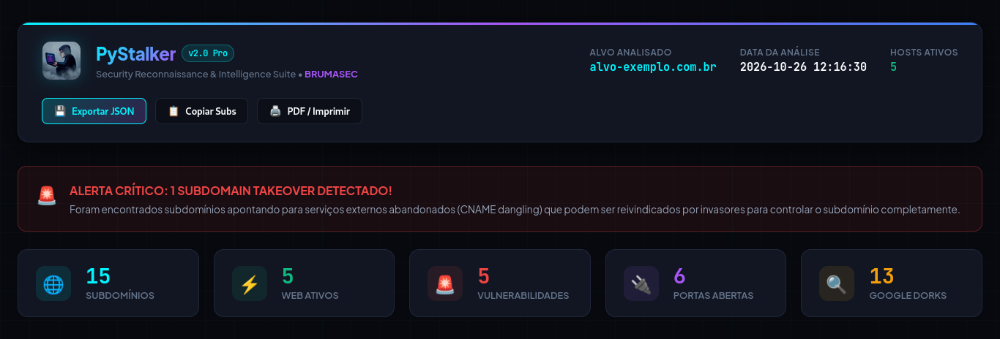
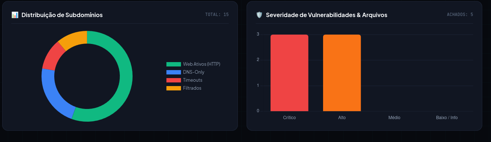
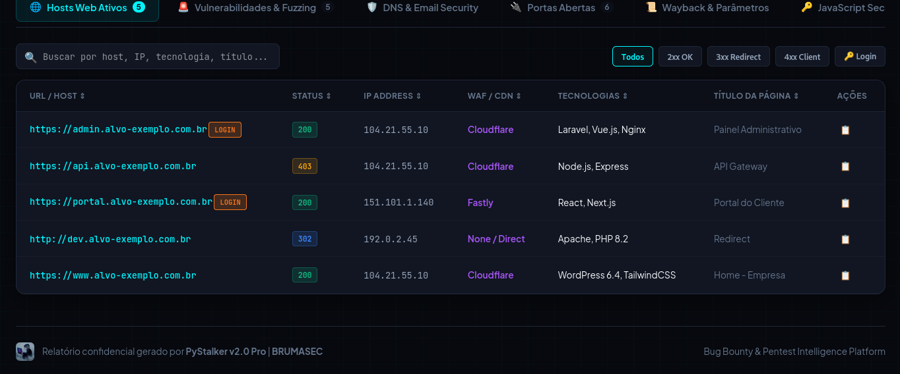
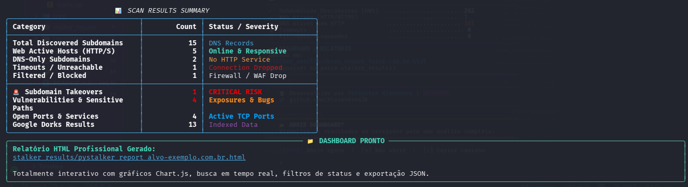

# ⚡ PyStalker v2.0 Pro - Ultimate Reconnaissance & Bug Bounty Framework

<div align="center">

[](https://www.python.org/)
[](https://www.kali.org/)
[](LICENSE)
[](#)
[](#)

<br>

**PyStalker** é um framework profissional automatizado de **Reconhecimento Web (OSINT)** e **Descoberta de Superfície de Ataque** desenvolvido especialmente para **Bug Bounty Hunters**, **Pentesters** e **Pesquisadores de Segurança Defensiva/Ofensiva**.

Ele combina as melhores ferramentas da comunidade (`Subfinder`, `Assetfinder`, `Findomain`, `httpx-toolkit`, `Waybackurls`, `Nuclei`) com scripts proprietários em Python para entregar uma análise completa, inteligente e acompanhada de um **Dashboard HTML moderno e interativo**.

</div>

---

## 📑 Sumário

- [Visão Geral dos Recursos](#-visão-geral-dos-recursos)
- [Pré-requisitos](#-pré-requisitos)
- [Tutorial de Instalação](#-tutorial-de-instalação-passo-a-passo)
  - [Método 1: Instalação Automática (Recomendada)](#-método-1-instalação-automática-rápida-recomendada)
  - [Método 2: Instalação Manual com Ambiente Virtual (venv)](#-método-2-instalação-manual-com-ambiente-virtual-venv)
- [Guia Prático de Uso](#-guia-prático-de-uso)
  - [1. Teste Visual Rápido (Modo Demonstração)](#1-teste-visual-rápido-sem-gastar-rede)
  - [2. Escaneamento Padrão de um Domínio](#2-escaneamento-padrão)
  - [3. Auditoria Completa (Modo Full)](#3-auditoria-completa-modo-full)
  - [4. Modo Rápido (Triagem de Velocidade)](#4-modo-rápido-fast-recon)
  - [5. Escanear Múltiplos Alvos em Lote (Lista)](#5-escanear-múltiplos-alvos-em-lote)
  - [6. Escanear com Port Scanner Ativo](#6-escanear-com-port-scanner-ativo)
  - [7. Escanear com Nuclei Scanner](#7-escanear-integrando-o-nuclei-scanner)
- [Entendendo os Resultados e Relatórios](#-entendendo-os-resultados-e-relatórios)
- [Configuração de Chaves de API (Opcional)](#-configuração-de-chaves-de-api-opcional)
- [Galeria de Fotos do Dashboard](#-galeria-do-dashboard)
- [Perguntas Frequentes & Solução de Problemas](#-solução-de-problemas-faq)
- [Aviso Legal (Disclaimer)](#-aviso-legal-disclaimer)

---

## 🌟 Visão Geral dos Recursos

| Módulo | Descrição |
|---|---|
| 🌐 **Subdomain Discovery** | Coleta passiva e ativa em múltiplas fontes: `Subfinder`, `Assetfinder`, `Findomain`, `Amass`, `crt.sh`, `Waybackurls` e DNS brute-force. |
| ⚡ **HTTP Probing & Tech** | Probing inteligente com `httpx-toolkit` / motor concorrente, identificando status code, título, WAF, servidor e tecnologias. |
| 🚨 **Subdomain Takeover** | Detecção automatizada de CNAMEs órfãos apontando para 12+ serviços em nuvem abandonados (GitHub Pages, AWS S3, Heroku, Shopify, Zendesk, etc.). |
| 🛡️ **DNS & Email Security** | Auditoria de registros SPF, DMARC e verificação se o domínio está vulnerável a ataques de **Email Spoofing**, além de teste de transferência de zona (AXFR). |
| 🔌 **Port Scanner Concorrente** | Varredura ultra-rápida de portas críticas em IPs únicos dos alvos (`80, 443, 8080, 8443, 8000, 3000, 5000, 3306, 6379, etc.`). |
| 📜 **Wayback & Endpoints** | Mineração histórica com `waybackurls` e filtragem inteligente de parâmetros propensos a bugs (`?id=`, `?url=`, `?redirect=`, `?file=`). |
| 🔑 **JavaScript Secrets** | Download e análise regex de arquivos `.js` em busca de rotas de API internas e tokens expostos (Google API, AWS, Slack, JWT). |
| 🧬 **Fuzzing & Vulnerabilidades** | Detecção de arquivos sensíveis expostos (`.env`, `.git`, backups, phpinfo), testes de XSS refletido e integração com **Nuclei**. |
| 🎯 **Google Dorks Prontos** | Geração de dorks avançados para arquivos sensíveis e painéis com botões de link direto para busca no Google em 1 clique. |
| 📊 **Dashboard HTML Interativo** | Gráficos Chart.js, busca em tempo real, ordenação por coluna, filtros por status HTTP, cópia rápida e exportação para JSON. |

---

## 📋 Pré-requisitos

Antes de instalar, certifique-se de que sua máquina possui:

- **Sistema Operacional**: Linux (Kali Linux, Ubuntu, Debian, Parrot OS ou WSL2 no Windows).
- **Python**: Versão `3.10` ou superior (`python3 --version`).
- **Git**: Instalado para clonar o repositório (`git --version`).
- **Acesso Sudo**: Necessário apenas para o instalador configurar pacotes de sistema e ferramentas de rede.

---

## 📥 Tutorial de Instalação Passo a Passo

### 🚀 Método 1: Instalação Automática Rápida (Recomendada)

O PyStalker inclui um script automatizado (`install.sh`) que atualiza dependências, instala o interpretador Go, compila ferramentas essenciais e configura as permissões:

```bash
# 1. Abra seu terminal e clone o repositório
git clone https://github.com/AlexandreG3k/PyStalker.git

# 2. Acesse a pasta do projeto
cd PyStalker

# 3. Dê permissão de execução ao instalador e ao executável
chmod +x install.sh PyStalker.py

# 4. Execute o instalador automático
./install.sh
```

> [!NOTE]
> O instalador verifica automaticamente as ferramentas instaladas no sistema (`subfinder`, `assetfinder`, `httpx-toolkit`, `waybackurls`, `nuclei`, `nmap`) e instala apenas o que estiver faltando.

---

### 🐍 Método 2: Instalação Manual com Ambiente Virtual (venv)

Se você prefere instalar as dependências Python em um ambiente virtual isolado:

```bash
# 1. Clone o repositório e acesse a pasta
git clone https://github.com/AlexandreG3k/PyStalker.git
cd PyStalker

# 2. Crie e ative o ambiente virtual
python3 -m venv venv
source venv/bin/activate

# 3. Instale as bibliotecas Python
pip install -r requirements.txt

# 4. Dê permissão de execução
chmod +x PyStalker.py
```

---

## 🎯 Guia Prático de Uso

### 1. Teste Visual Rápido (Sem Gastar Rede)
Execute o **Modo Mock** para ver o banner moderno, as tabelas dinâmicas do terminal e gerar um Dashboard HTML completo com dados de exemplo:

```bash
python3 PyStalker.py --mock
```

---

### 2. Escaneamento Padrão
Executa a descoberta de subdomínios, probing HTTP, identificação de tecnologias, classificação de hosts e fuzzing básico de arquivos sensíveis:

```bash
python3 PyStalker.py alvo.com
```

---

### 3. Auditoria Completa (Modo Full)
Executa todo o arsenal de inteligência: subdomínios, port scanning, verificação de takeover, segurança de e-mail, mineração de parâmetros históricos via Wayback Machine, análise de scripts JavaScript e fuzzing profundo:

```bash
python3 PyStalker.py alvo.com --full
```

---

### 4. Modo Rápido (Fast Recon)
Prioriza ferramentas mais leves para obter uma lista de subdomínios e hosts ativos em poucos segundos:

```bash
python3 PyStalker.py alvo.com --fast
```

---

### 5. Escanear Múltiplos Alvos em Lote
Crie um arquivo de texto com a lista de domínios (um por linha) e execute:

```bash
# Crie seu arquivo de alvos
nano alvos.txt
```
*Exemplo de `alvos.txt`:*
```text
empresa1.com.br
empresa2.com
teste.org
```

Execute a varredura em lote:
```bash
python3 PyStalker.py -l alvos.txt --full
```

---

### 6. Escanear com Port Scanner Ativo
Para realizar varredura de portas TCP críticas (`80, 443, 8080, 8443, 8000, 3000, 3306, 6379, etc.`) nos endereços IP dos subdomínios ativos:

```bash
python3 PyStalker.py alvo.com --ports
```

---

### 7. Escanear Integrando o Nuclei Scanner
Dispare varreduras de templates do Nuclei nos hosts web ativos encontrados:

```bash
python3 PyStalker.py alvo.com --nuclei
```

---

### 8. Fuzzing Direcionado por Tecnologia
Ajuste os payloads de XSS e caminhos sensíveis de acordo com a stack da aplicação:

```bash
python3 PyStalker.py alvo.com --tech laravel
python3 PyStalker.py alvo.com --tech php
python3 PyStalker.py alvo.com --tech nodejs
```

---

## 📊 Entendendo os Resultados e Relatórios

Ao término da execução, todos os artefatos são salvos automaticamente no diretório `stalker_results/`:

```text
stalker_results/
├── pystalker_report_<alvo>.html        <-- Dashboard HTML Interativo
├── pystalker_<alvo>_<timestamp>.json   <-- Relatório bruto estruturado em JSON
└── subdomains_<alvo>.txt               <-- Lista limpa de subdomínios (TXT)
```

### Como abrir o Dashboard no Navegador:
1. Ao final do scan, o terminal perguntará se deseja abrir. Basta pressionar **[ENTER]**.
2. Ou abra manualmente no seu navegador padrão:
   ```bash
   xdg-open stalker_results/pystalker_report_alvo.com.html
   ```

### Recursos do Dashboard HTML:
- 🔍 **Barra de Pesquisa**: Digite qualquer termo para filtrar instantaneamente subdomínios, IPs ou tecnologias.
- 🎯 **Filtros Rápidos**: Botões no topo da tabela para alternar entre códigos `2xx`, `3xx`, `4xx`, `5xx` e `🔑 Login`.
- 📋 **Botão de Copiar**: Clique no ícone `📋` ao lado de qualquer host para copiá-lo diretamente para a área de transferência.
- 💾 **Exportar JSON / Copiar Todos**: Botões no cabeçalho para baixar o arquivo JSON ou copiar todos os subdomínios de uma vez.

---

## 🔑 Configuração de Chaves de API (Opcional)

O PyStalker funciona perfeitamente de forma 100% gratuita sem chaves de API. No entanto, se você possuir contas no Shodan ou SecurityTrails, você pode enriquecer a coleta definindo variáveis de ambiente no seu terminal:

```bash
# Adicione suas chaves no seu ~/.bashrc ou exporte no terminal:
export SHODAN_API_KEY="sua_chave_shodan_aqui"
export SECURITYTRAILS_API_KEY="sua_chave_securitytrails_aqui"
export GOOGLE_API_KEY="sua_chave_google_aqui"
export GOOGLE_CSE_ID="seu_custom_search_id_aqui"
```

---

## 🖼️ Galeria do Dashboard

<div align="center">

### Visão Geral & Gráficos Interativos


<br><br>

### Tabela de Hosts e Classificação


<br><br>

### Relatório de Vulnerabilidades & Paths Sensíveis


<br><br>

### Terminal Cyberpunk com Rich


</div>

---

## ❓ Solução de Problemas (FAQ)

### 1. `Permission denied` ao executar os arquivos
Conceda permissão de execução nos scripts:
```bash
chmod +x install.sh PyStalker.py
```

### 2. Erro de ambiente gerenciado externamente (`error: externally-managed-environment`)
Distribuições modernas do Linux (como Kali 2024+ e Debian 12+) protegem o Python do sistema. Para instalar as dependências:
```bash
pip3 install -r requirements.txt --break-system-packages
```
*Ou utilize um ambiente virtual com `python3 -m venv venv && source venv/bin/activate`.*

### 3. Ferramentas como `subfinder` ou `waybackurls` não encontradas
Certifique-se de que o diretório `$HOME/go/bin` está no seu `$PATH`:
```bash
echo 'export PATH=$PATH:$HOME/go/bin:/usr/local/bin' >> ~/.bashrc
source ~/.bashrc
```

### 4. O Dashboard não abriu automaticamente
Em ambientes sem interface gráfica (ex: VPS / SSH ou WSL sem display), use a tecla `c` para copiar o caminho ou transfira o arquivo `.html` gerado na pasta `stalker_results/` para abrir na sua máquina local.

---

## ⚖️ Aviso Legal (Disclaimer)

O **PyStalker v2.0 Pro** é uma ferramenta de auditoria e segurança defensiva desenvolvida para profissionais autorizados e entusiastas de segurança cibernética.

- **Autorização Obrigatória**: Nunca execute testes de segurança contra domínios, servidores ou aplicações sem autorização prévia por escrito do proprietário.
- **Isenção de Responsabilidade**: Os desenvolvedores e mantenedores (**BRUMASEC**) não se responsabilizam por qualquer uso indevido, danos acidentais ou violações de termos de serviço causadas pelo uso deste software.
- Sempre respeite as políticas de divulgação responsável e os termos de programas de Bug Bounty.

---

<div align="center">

Desenvolvido com 💜 por **BRUMASEC** • Se este projeto te ajudou, deixe uma estrela ⭐ no GitHub!

</div>
